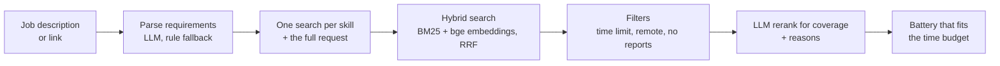

# SHL Assessment Recommender

[](https://github.com/saccromcyes/SHL/actions/workflows/ci.yml)
[](https://huggingface.co/spaces/saccromcyes/shl-recommender)
[](LICENSE)

Paste a job description (or a link to one) and get up to ten assessments from SHL's catalog of 377 products that **cover every skill the role needs, fit the time limit, and come with a reason for each pick**. It also proposes a test battery that fits the candidate's session.

**[Try it →](https://huggingface.co/spaces/saccromcyes/shl-recommender)**

<!-- Screenshot added after the first deploy: docs/screenshot.png -->

## The problem with "just embed it"

The first version of this project embedded assessment names and returned the nearest neighbours. That fails in three predictable ways:

1. **One skill crowds out the rest.** "Java developer who collaborates with business teams" returns five Java tests and nothing for collaboration.
2. **Constraints are ignored.** "Each test under 40 minutes" is text to an embedding model, not a filter.
3. **Wrong kind of product.** 63 catalog entries are *reports* generated from other tests, not tests a candidate can take.

## How it works



- **Requirement parsing.** A fast model extracts skills, job level, time limit, remote-testing needs and requested test types as JSON. Explicit limits ("under 40 minutes") are also parsed with a regex, which wins over the model when they disagree. Without an LLM, rules do the same job less flexibly.
- **Query decomposition.** When an LLM has parsed the request, each skill gets its own search, plus one for the whole request, merged with weighted reciprocal rank fusion so every skill places its best matches near the top. With rule-based parsing this measured slightly *worse* than one hybrid search (Recall@10 0.756 vs 0.782 with real embeddings), so the no-LLM fallback skips it.
- **Hybrid search.** BM25 catches exact technology names ("Kafka", "C#"); embeddings catch intent ("handles angry customers" → customer service simulations). With 377 items the dense index is a 377 × 384 matrix, so search is one matrix product; a vector database would be overhead.
- **Coverage-aware reranking.** An LLM picks and orders the final ten from 30 candidates with explicit rules: cover every skill, include a behavioural test when soft skills matter, prefer the right job level, never invent tests. Invalid or duplicate IDs are dropped. Without an LLM, a round-robin over the per-skill rankings gives the same balance.
- **Battery builder.** Greedily assembles the highest-ranked tests that fit the time budget together, preferring a mix of test types.
- **Safe link reading.** Job-posting URLs are fetched with SSRF protection: http(s) only, private and metadata addresses refused on every redirect, size and time limits.

## Results

28 hiring requests, each labelled by hand with the assessments a recruiter would expect (169 labels in [`eval/labeled_queries.jsonl`](eval/labeled_queries.jsonl)). Each row is one configuration of the pipeline, so the table shows what each stage contributes, including the one that didn't help.

<!-- EVAL:START -->
_Last run 2026-11-14, commit `1b9c519`, embeddings `BAAI/bge-small-en-v1.5`, LLM `none`. 28 labeled queries, 169 relevant assessments._

| Pipeline stage | Mean Recall@10 | MAP@10 |
|---|---|---|
| Keyword search (BM25) | 0.707 | 0.605 |
| Embedding search | 0.704 | 0.583 |
| Hybrid (RRF) | 0.782 | 0.692 |
| + one search per skill | 0.756 | 0.647 |
| **+ balanced selection** | **0.756** | 0.661 |
<!-- EVAL:END -->

The labels were written for this project rather than taken from SHL, so treat absolute numbers as indicative; the comparison between stages is the useful part.

## API

| Endpoint | Purpose |
|---|---|
| `POST /api/recommend` | `{"query": "...", "overrides": {"max_minutes": 30}}`. Returns parsed requirements, ranked results with reasons, the battery, and pipeline timings. |
| `POST /recommend` | The response shape from the original SHL assignment (`recommended_assessments` with url, name, duration, test_type…). |
| `GET /health` | `{"status": "healthy"}` |
| `GET /api/catalog/stats`, `/api/eval` | Catalog breakdown and the latest evaluation. |

Interactive docs at `/api/docs`.

## Run locally

```bash
cp .env.example .env            # optional: add an LLM_API_KEY (free at console.groq.com)
docker build -t shl-recommender . && docker run -p 7860:7860 --env-file .env shl-recommender
```

```bash
pip install -r requirements-dev.txt
uvicorn recommender.main:app --reload --port 7860
pytest                               # 33 tests, offline
python -m eval.run_eval --no-llm     # retrieval stages; add LLM_API_KEY for the full pipeline
```

Deployment to Hugging Face Spaces runs from GitHub Actions after CI passes: set secrets `HF_TOKEN` and `LLM_API_KEY`, and variable `HF_SPACE`.

## Project layout

```
recommender/
  catalog.py   parse durations ("15 to 35 mins", "max 45 mins"), test types, report detection
  query.py     requirement extraction (LLM JSON + rule fallback)
  search.py    BM25 + dense search, weighted RRF, filters
  rerank.py    LLM coverage rerank, balanced fallback, battery builder
  fetch.py     SSRF-safe job-posting fetcher
  service.py   the pipeline, with switches used by the evaluation
  main.py      FastAPI app
data/          the scraped catalog (scripts/scrape_catalog.py)
eval/          labelled queries, evaluation harness, results
web/           the interface
```

## Notes

Catalog data comes from SHL's public product catalog. This project is not affiliated with or endorsed by SHL.
